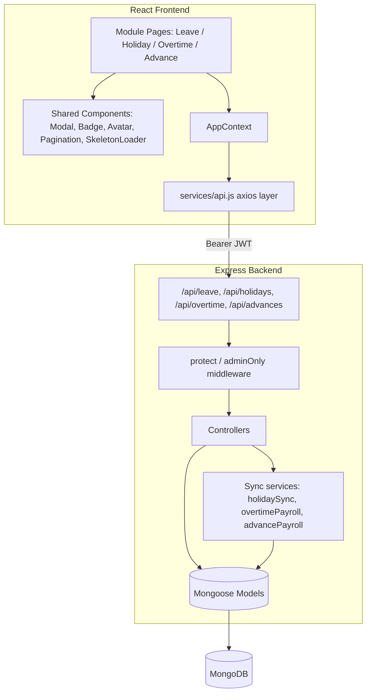
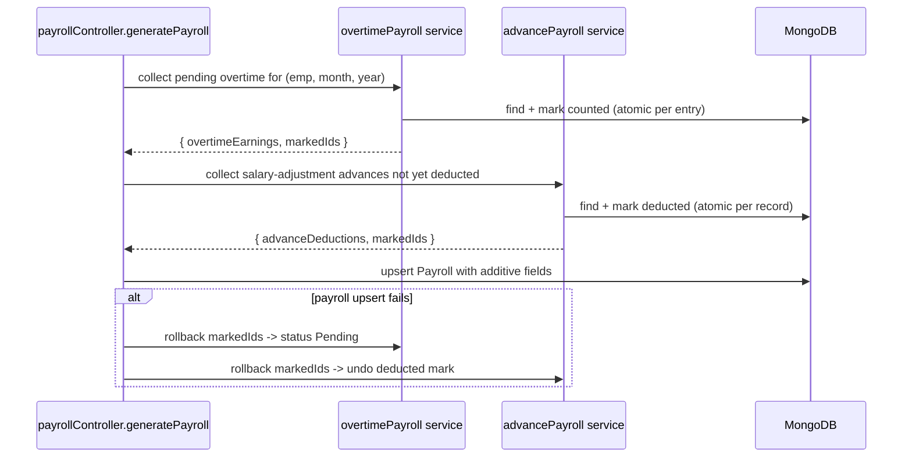
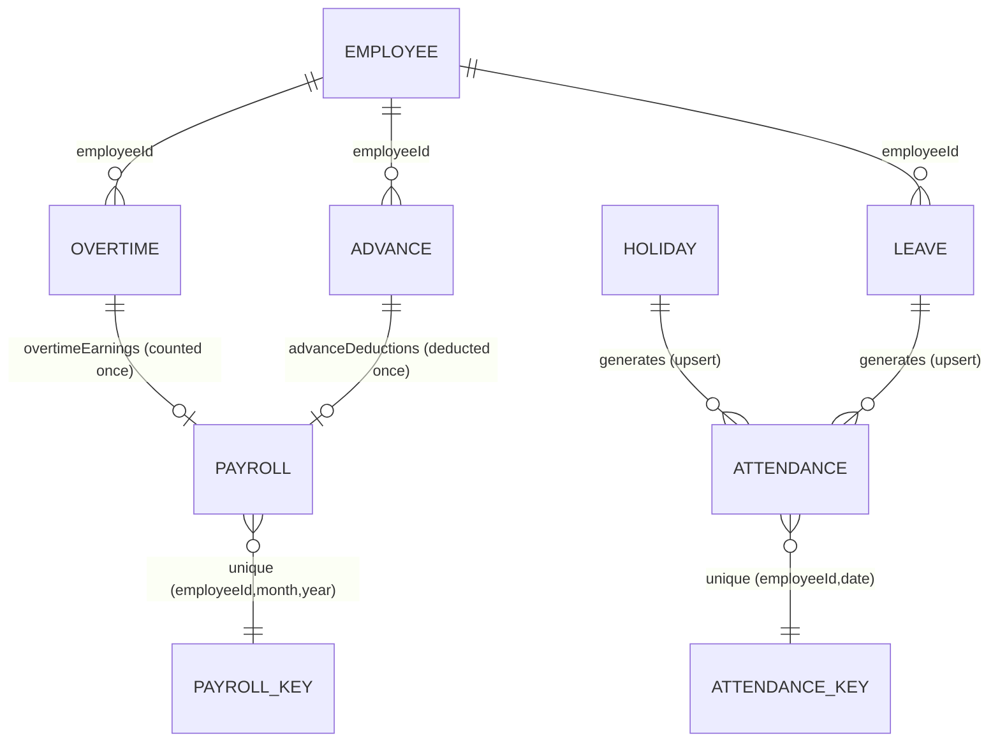

# Design Document

## Overview

This feature integrates four HR management modules — Leave, Holiday, Overtime, and Daily Advances — into the existing MERN Employee Management System (EMS). The Leave module already exists and is extended additively; the Holiday, Overtime, and Advance modules are net-new on both backend and frontend.

The design follows the established EMS conventions exactly:

- **Backend**: Express routers mounted under `/api/*` in `server.js`; controllers returning the `{ success, data, count }` response envelope; Mongoose models with a string `employeeId` plus an optional `userId` ObjectId; `protect` applied to every route and `adminOnly` (Admin + HR) on mutating routes; employee-scoped list queries using `$or: [{ userId }, { email }]`.
- **Frontend**: React pages under `src/pages/<module>/`; routes registered in `App.js` inside the `AppLayout` (admin/HR) and `EmployeeLayout` (employee) route groups; data access through a single `AppContext` provider wrapping the `services/api.js` axios layer; reuse of the shared `Modal`, `Badge`, `Avatar`, `Pagination`, and `SkeletonLoader` components; employee directory loaded via `AppContext.employees`.

The central technical challenge is **cross-module synchronization** performed on the backend without corrupting existing data or double-counting:

1. **Holiday → Attendance** (Req 7): active holidays produce exactly one `Attendance` record per `(employeeId, date)` with status `leave`, respecting the existing unique index and coexisting with approved leave on the same day.
2. **Overtime → Payroll** (Req 9): pending overtime for a payroll month/year is summed into an additive earnings amount, each contributing entry is marked `counted` so it is never summed twice, and the marking is rolled back if payroll generation fails.
3. **Advance → Payroll** (Req 11): salary-adjustment advances are summed into an additive deduction exactly once, each marked with the month/year it was deducted in and excluded from all later generations.

Research into the existing code confirmed three constraints that shape the design:

- The existing `Attendance` model enforces `{ employeeId, date }` unique, and `leaveController.updateLeaveStatus` already upserts `status: 'leave'` per day. Holiday sync must use the same upsert-by-`(employeeId, date)` pattern so a holiday + leave on the same day never produces two records. (Source: `models/Attendance.js`, `controllers/leaveController.js`.)
- The existing `Payroll` model has fixed earning/deduction fields (`basic`, `hra`, `allowances`, `bonus`, `tax`, `insurance`, `otherDeductions`) and a `{ employeeId, month, year }` unique index. The requirements forbid changing the meaning of those fields, so overtime earnings and advance deductions must be stored in **new additive fields** rather than folded into existing ones. (Source: `models/Payroll.js`, Req 9.3 / 11.5 / 18.4.)
- The existing `Leave` enum does not contain "Earned"; the screenshot "Earned" label must be mapped to the stored enum value `Annual Leave` on submit, leaving the enum unchanged. (Source: `models/Leave.js`, Req 2.3 / 18.1.)

## Architecture

### System Context



### Request Flow (new modules)

Every new route mirrors the existing leave route pattern:

```javascript
router.use(protect);                 // all routes authenticated
router.get('/', getAll);             // list (role-scoped)
router.post('/', adminOnly, create); // Admin/HR only
router.put('/:id', adminOnly, update);
router.delete('/:id', adminOnly, remove);
```

Mounting in `server.js` (additive, alongside existing mounts):

```javascript
const holidayRoutes  = require('./routes/holidayRoutes');
const overtimeRoutes = require('./routes/overtimeRoutes');
const advanceRoutes  = require('./routes/advanceRoutes');
app.use('/api/holidays', holidayRoutes);
app.use('/api/overtime', overtimeRoutes);
app.use('/api/advances', advanceRoutes);
```

### Synchronization Architecture

The three sync concerns are implemented as **pure-logic service functions** separated from the I/O layer. This keeps the double-counting and rollback logic unit- and property-testable in isolation, with the controllers responsible for persistence.



### Technology Choices

- **No new runtime dependencies.** The feature uses the existing stack (Express, Mongoose, React, axios, react-hot-toast, lucide-react).
- **Printing** (Req 12.3) uses the browser `window.print()` against a print-scoped rendering of the filtered rows — no PDF library required.
- **Export** (Req 12.2) produces a client-side CSV blob from the currently filtered records — no server round trip and no new dependency.
- **Property-based tests** will use `fast-check` with Jest (the backend's existing test ecosystem), added as a dev dependency only.

## Components and Interfaces

### Backend Endpoints

#### Holiday Module (`/api/holidays`)

| Method | Path | Middleware | Description |
| --- | --- | --- | --- |
| GET | `/api/holidays` | `protect` | List all holidays (`{ success, count, data }`) |
| GET | `/api/holidays/:id` | `protect` | Single holiday; 404 `{ success:false }` if missing |
| POST | `/api/holidays` | `protect, adminOnly` | Create holiday |
| PUT | `/api/holidays/:id` | `protect, adminOnly` | Update holiday |
| DELETE | `/api/holidays/:id` | `protect, adminOnly` | Delete holiday |

#### Overtime Module (`/api/overtime`)

| Method | Path | Middleware | Description |
| --- | --- | --- | --- |
| GET | `/api/overtime` | `protect` | List; employee role scoped to own records |
| POST | `/api/overtime` | `protect, adminOnly` | Log overtime (computes `totalAmount`, status `Pending`) |
| PUT | `/api/overtime/:id` | `protect, adminOnly` | Update entry (recomputes `totalAmount`) |
| PUT | `/api/overtime/:id/settle` | `protect, adminOnly` | Set status `Paid` |
| DELETE | `/api/overtime/:id` | `protect, adminOnly` | Delete entry |

#### Advance Module (`/api/advances`)

| Method | Path | Middleware | Description |
| --- | --- | --- | --- |
| GET | `/api/advances` | `protect` | List; employee role scoped to own records |
| POST | `/api/advances` | `protect, adminOnly` | Give advance (status `Pending`) |
| PUT | `/api/advances/:id` | `protect, adminOnly` | Update record / set status |
| DELETE | `/api/advances/:id` | `protect, adminOnly` | Delete record |

#### Leave Module (existing, extended additively)

Endpoints unchanged (`GET /api/leave`, `GET /api/leave/balance`, `POST /api/leave`, `PUT /api/leave/:id/status`, `PUT /api/leave/:id/cancel`). The Earned→Annual mapping is a **frontend submit transformation**; no backend change to the enum or `applyLeave` logic.

### Backend Sync Service Interfaces

```javascript
// services/holidaySync.js
// Returns the attendance upsert descriptors for an active holiday on a given date.
// Pure: computes which (employeeId, date) pairs need an upsert; no date produces
// more than one descriptor per (employeeId, date).
function holidayAttendanceUpserts(holiday, date, applicableEmployees) { /* ... */ }

// Expands a Weekly/Monthly/Festival/Custom Holiday_Rule into concrete dates in a range.
function expandHolidayRule(holiday, rangeStart, rangeEnd) { /* -> string[] 'YYYY-MM-DD' */ }

// services/overtimePayroll.js
// Pure sum of Pending, not-yet-counted overtime amounts for (month, year).
function overtimeEarningsFor(entries, month, year) { /* -> { amount, entryIds } */ }

// services/advancePayroll.js
// Pure sum of Salary Adjustment, not-yet-deducted advances dated on/before period end.
function advanceDeductionsFor(records, month, year) { /* -> { amount, recordIds } */ }
```

### Frontend Pages and Routes

New pages reuse the `LeaveRequests.js` structure (search/filter/pagination/modal). Routes are added inside the existing `AppLayout` group in `App.js`; employee-visible lists are added to the employee portal where applicable.

| Module | Page files | Admin routes |
| --- | --- | --- |
| Holiday | `HolidayRecords.js`, `HolidayCalendar.js` | `/holidays/records`, `/holidays/calendar` |
| Overtime | `OvertimeRecords.js` | `/overtime/records` |
| Advance | `AdvanceRecords.js` | `/advances/records` |
| Leave (extend) | `LeaveRequests.js`, `ApplyLeave.js`, `LeaveBalance.js` | existing |

Sidebar entries are appended to `NAV_ITEMS` in `Sidebar.js` following the existing `sub`-menu pattern.

### Frontend AppContext Extensions

New state and CRUD helpers are added to `AppContext` mirroring the existing leave helpers, with matching optimistic list updates and error throwing:

```javascript
// new state
holidays, overtimeEntries, advanceRecords
// new fetchers (loaded in the post-login useEffect)
fetchHolidays, fetchOvertime, fetchAdvances
// new CRUD helpers
addHoliday, updateHoliday, deleteHoliday
addOvertime, updateOvertime, settleOvertime, deleteOvertime
addAdvance, updateAdvance, deleteAdvance
```

New API groups are added to `services/api.js`:

```javascript
export const holidayAPI  = { getAll, getById, create, update, delete };
export const overtimeAPI = { getAll, create, update, settle, delete };
export const advanceAPI  = { getAll, create, update, delete };
```

### Shared Component Reuse

- `Modal` / `ConfirmModal` — detail views, create/edit forms, delete confirmation (Req 12.4).
- `Badge` — status chips (leave status, Overtime_Status, Advance_Status, holiday status).
- `Avatar` — employee cells in list rows.
- `Pagination` — fixed `PAGE_SIZE = 10`, matching `LeaveRequests.js` (Req 1.6).
- `SkeletonLoader` — list/detail loading states (Req 1.7, 17.1).

## Data Models

### Holiday (net-new `Holiday` collection)

```javascript
const holidaySchema = new mongoose.Schema({
  holidayName: { type: String, required: true },
  type:        { type: String, required: true, enum: ['Weekly', 'Monthly', 'Festival', 'Custom'] },
  // Holiday_Rule: fixed date for Festival/Custom; recurrence spec for Weekly/Monthly
  date:        { type: String, default: null },            // 'YYYY-MM-DD' for Festival/Custom
  recurrence:  {                                            // for Weekly/Monthly
    dayOfWeek:   { type: Number, default: null },           // 0-6 for Weekly
    dayOfMonth:  { type: Number, default: null },           // 1-31 for Monthly
  },
  status:      { type: String, enum: ['active', 'inactive'], default: 'active', index: true },
  description: { type: String, default: '' },
  paidStatus:  { type: String, enum: ['Paid', 'Unpaid'], default: 'Paid' },
  applicableAll:      { type: Boolean, default: true },
  applicableEmployees: [{ type: String }],                 // employeeId subset when applicableAll=false
  employeeId:  { type: String, index: true },              // convention: creator/owner, optional
  userId:      { type: mongoose.Schema.Types.ObjectId, ref: 'User', index: true },
}, { timestamps: true });
```

`Holiday_Rule` validity invariant: Festival/Custom require `date`; Weekly requires `recurrence.dayOfWeek`; Monthly requires `recurrence.dayOfMonth` (Req 5.5).

### Overtime (net-new `Overtime` collection)

```javascript
const overtimeSchema = new mongoose.Schema({
  employeeId:      { type: String, required: true, index: true },
  userId:          { type: mongoose.Schema.Types.ObjectId, ref: 'User', index: true },
  email:           { type: String, index: true },
  employeeName:    { type: String },
  date:            { type: String, required: true },       // 'YYYY-MM-DD'
  durationHours:   { type: Number, default: 0, min: 0 },
  durationMinutes: { type: Number, default: 0, min: 0 },
  ratePerHour:     { type: Number, required: true, min: 0 },
  totalAmount:     { type: Number, default: 0 },           // (hours + minutes/60) * ratePerHour
  reason:          { type: String, default: '' },
  status:          { type: String, enum: ['Pending', 'Paid'], default: 'Pending', index: true },
  // payroll-sync bookkeeping
  counted:         { type: Boolean, default: false, index: true },
  countedMonth:    { type: String, default: null },
  countedYear:     { type: Number, default: null },
}, { timestamps: true });
```

`totalAmount = (durationHours + durationMinutes / 60) * ratePerHour`, computed on create/update (Req 8.4).

### Advance (net-new `Advance` collection)

```javascript
const advanceSchema = new mongoose.Schema({
  employeeId:    { type: String, required: true, index: true },
  userId:        { type: mongoose.Schema.Types.ObjectId, ref: 'User', index: true },
  email:         { type: String, index: true },
  employeeName:  { type: String },
  date:          { type: String, required: true },         // 'YYYY-MM-DD'
  amount:        { type: Number, required: true, min: 0.01 },
  paymentMethod: { type: String, enum: ['Cash', 'UPI', 'Bank'], default: 'Cash' },
  reason:        { type: String, default: '' },
  status:        { type: String, enum: ['Pending', 'Settled/Returned', 'Salary Adjustment'], default: 'Pending', index: true },
  // payroll-sync bookkeeping
  deducted:      { type: Boolean, default: false, index: true },
  deductedMonth: { type: String, default: null },
  deductedYear:  { type: Number, default: null },
}, { timestamps: true });
```

### Payroll (existing — additive extension only)

Two new additive fields are added; **no existing field changes meaning** (Req 9.3, 11.5, 18.4):

```javascript
// appended to the existing payrollSchema
overtimeEarnings:  { type: Number, default: 0 },  // additive to gross pay
advanceDeductions: { type: Number, default: 0 },  // additive to deductions
```

The `{ employeeId, month, year }` unique index is preserved (Req 9.6, 11.6).

### Attendance (existing — unchanged schema)

Holiday sync reuses the existing schema and `{ employeeId, date }` unique index. No schema change (Req 7.6). The `overtime` field (Computed_Attendance_Overtime) is never written by this feature (Req 8.8, 18.3).

### Leave (existing — unchanged schema)

The enum is untouched. The Earned→"Annual Leave" mapping happens at frontend submit time (Req 18.1).

### Data Model Relationships



## Correctness Properties

*A property is a characteristic or behavior that should hold true across all valid executions of a system — essentially, a formal statement about what the system should do. Properties serve as the bridge between human-readable specifications and machine-verifiable correctness guarantees.*

The properties below are derived from the prework analysis. Redundant acceptance criteria were consolidated (for example, the per-module employee scoping rules collapse into one property, and the attendance de-duplication criteria collapse into one uniqueness property). Each property is universally quantified and maps to the requirement clauses it validates.

### Property 1: Employee list scoping

*For any* set of module records (leave, overtime, or advance) and any authenticated user whose Role is Employee, the scoped list returned to that user SHALL contain only records whose `userId` or `email` matches that user, and SHALL contain every such matching record.

**Validates: Requirements 1.2, 8.2, 10.2, 16.3**

### Property 2: List filtering returns the exact matching subset

*For any* record list and any combination of search term, status filter, and type filter, the filtered result SHALL equal exactly the records that satisfy all active filters (search matches employee name or record id; status equals the selected status; type equals the selected type) — no non-matching record is included and no matching record is omitted.

**Validates: Requirements 1.3, 1.4, 1.5**

### Property 3: Earned leave type maps to a valid stored enum value

*For any* Leave_Type label offered in the apply-leave form, the submitted `leaveType` value SHALL be a member of the existing `Leave` enum, and the label "Earned" SHALL map to the stored value "Annual Leave" while every other label maps to itself.

**Validates: Requirements 2.3, 18.1**

### Property 4: Apply-leave date-range and days validation

*For any* submitted leave request, the submission SHALL be accepted with respect to range/size validation if and only if the submitted `endDate` is not earlier than the submitted `startDate` and the submitted `days` value is at least 0.5; otherwise it SHALL be rejected and no Leave_Record created.

**Validates: Requirements 2.4, 2.5**

### Property 5: Overlapping leave rejection

*For any* set of existing Leave_Records for a user and any new requested date range, the new request SHALL be rejected if and only if the range intersects at least one existing Leave_Record for that user whose status is pending or approved.

**Validates: Requirements 2.6**

### Property 6: Balance check applies only to tracked types

*For any* approved-leave history and any new request, when the Leave_Type is balance-tracked the request SHALL be rejected if and only if the requested days exceed the remaining balance; when the Leave_Type is untracked (Unpaid_Leave) no balance-based rejection SHALL occur.

**Validates: Requirements 2.7, 2.8**

### Property 7: Leave status-transition guard

*For any* Leave_Record whose current status is already approved, rejected, or cancelled, an approve or reject action SHALL be rejected with an error indicating the current status, leaving the record's status unchanged.

**Validates: Requirements 4.3**

### Property 8: Attendance uniqueness per (employeeId, date)

*For any* combination of approved leave day ranges and active holidays that resolve to the same calendar day for an employee, the System SHALL maintain exactly one Attendance_Record per `(employeeId, date)` with status "leave", never creating a second record for the same `(employeeId, date)`.

**Validates: Requirements 4.5, 7.4, 7.6**

### Property 9: Holiday recurrence expansion is sound and complete

*For any* Weekly or Monthly Holiday_Rule and any date range, the set of occurrence dates produced SHALL contain exactly the dates in that range that match the rule — every produced date matches the rule and lies in range, and every matching date in range is produced.

**Validates: Requirements 6.3, 7.5**

### Property 10: Upcoming holidays filtering and ordering

*For any* set of Holiday_Records, the Upcoming Holidays list SHALL equal exactly the records whose applicable date is on or after the current date, arranged in ascending date order.

**Validates: Requirements 6.2**

### Property 11: Holiday sync affects only applicable employees on matching dates

*For any* active Holiday_Record, employee, and date: the System SHALL record an Attendance_Record with status "leave" for that employee and date if and only if the date matches the Holiday_Record's Holiday_Rule and the employee is in its Applicable_Employees; in all other cases the System SHALL NOT create or modify that employee's Attendance_Record on account of that Holiday_Record.

**Validates: Requirements 7.1, 7.2, 7.3**

### Property 12: Holiday form validation

*For any* Add/Edit Holiday submission, the submission SHALL be accepted if and only if `holidayName` and Holiday_Type are present and a valid Holiday_Rule is present for that type (a date for Festival/Custom, a recurrence specification for Weekly/Monthly); otherwise it SHALL be rejected and no Holiday_Record persisted.

**Validates: Requirements 5.5**

### Property 13: Record persistence round-trip

*For any* valid record in the Holiday, Overtime, or Advance module, creating or editing it and then reading it back through the module's list/get endpoint SHALL return a record whose stored field values equal the submitted values (including the selected employee's `employeeId` and, for holidays, the Applicable_Employees subset); and after deletion the record SHALL NOT appear in the list.

**Validates: Requirements 5.3, 5.6, 5.7, 5.8, 8.3, 10.3, 14.2, 15.1, 15.2**

### Property 14: Overtime amount formula

*For any* non-negative `durationHours`, `durationMinutes`, and `ratePerHour`, the persisted Overtime_Amount SHALL equal `(durationHours + durationMinutes / 60) * ratePerHour`.

**Validates: Requirements 8.4**

### Property 15: Overtime input validation

*For any* Log Overtime submission, the submission SHALL be accepted if and only if at least one of `durationHours` or `durationMinutes` is greater than zero and `ratePerHour` is non-negative; otherwise it SHALL be rejected.

**Validates: Requirements 8.5**

### Property 16: Overtime logging does not alter computed attendance overtime

*For any* sequence of Overtime_Module operations, the existing Computed_Attendance_Overtime (`Attendance.overtime`) values for all employees SHALL remain unchanged.

**Validates: Requirements 8.8, 18.3**

### Property 17: Overtime earnings equal the qualifying sum

*For any* set of Overtime_Entries and any payroll month and year, the overtime earnings added to the Payroll_Record SHALL equal the sum of Overtime_Amount across entries whose status is "Pending", that are not already counted, and whose date falls within that month and year; when no such entry exists the added amount SHALL be 0.

**Validates: Requirements 9.1, 9.2**

### Property 18: Overtime counted at most once

*For any* sequence of payroll generations for an employee, each Overtime_Entry's Overtime_Amount SHALL contribute to the overtime earnings of at most one Payroll_Record.

**Validates: Requirements 9.4**

### Property 19: Overtime marking rolls back on payroll failure

*For any* set of Overtime_Entries marked as counted during a payroll generation that subsequently fails, the System SHALL restore those entries to their prior status so that none is excluded from a later successful generation (the post-failure state equals the pre-generation state).

**Validates: Requirements 9.5**

### Property 20: Advance deductions equal the qualifying sum

*For any* set of Advance_Records and any payroll month and year, the advance deductions added to the Payroll_Record SHALL equal the sum of amounts of records whose status is Salary_Adjustment, that are not already deducted, and whose date is on or before the last day of that month and year; records with status Settled/Returned or Pending SHALL contribute 0.

**Validates: Requirements 11.1, 11.4**

### Property 21: Advance deducted at most once

*For any* sequence of payroll generations, each Advance_Record SHALL contribute to the advance deductions of at most one Payroll_Record, and once marked deducted it SHALL be excluded from every subsequent generation.

**Validates: Requirements 11.2, 11.3**

### Property 22: Additive preservation of existing payroll fields

*For any* payroll generation, the stored values of the existing `basic`, `hra`, `allowances`, `bonus`, `tax`, `insurance`, and `otherDeductions` fields SHALL equal the values supplied for generation, with overtime earnings and advance deductions recorded only in the new additive fields.

**Validates: Requirements 9.3, 11.5, 18.4**

### Property 23: Payroll uniqueness per (employeeId, month, year)

*For any* sequence of payroll generations, there SHALL be at most one Payroll_Record per `(employeeId, month, year)`.

**Validates: Requirements 9.6, 11.6**

### Property 24: Advance amount validation

*For any* Give Advance submission, the submission SHALL be accepted if and only if the amount is greater than zero; otherwise it SHALL be rejected.

**Validates: Requirements 10.5**

### Property 25: Export reflects the currently filtered records

*For any* record list and any active filter state, the set of records produced by the Export action SHALL equal exactly the set of records currently visible under those filters.

**Validates: Requirements 12.2**

## Error Handling

### Backend

- **Authentication / authorization**: handled entirely by the existing `protect` and `adminOnly` middleware. Missing/invalid token → HTTP 401 `{ success:false }` (Req 16.1); Employee/Manager mutation attempt → HTTP 403 `{ success:false }` (Req 16.2, 13.4). No new auth logic is written.
- **Validation errors**: controllers return HTTP 400 with `{ success:false, message }` describing the specific failure (invalid date range, days < 0.5, zero duration, negative/zero amount, missing holiday fields), mirroring `applyLeave`'s messages. The record is not persisted.
- **Not found**: GET/PUT/DELETE by id on a missing record returns HTTP 404 `{ success:false, message }` (Req 13.6).
- **Unexpected errors**: wrapped in `try/catch` returning HTTP 500 `{ success:false, message: err.message }`, consistent with every existing controller; the global `errorHandler` remains the final safety net.
- **Sync atomicity**: `generatePayroll` collects overtime/advance marks first, performs the payroll upsert, and on any thrown error reverts the collected marks (Property 19, 21) before surfacing the error. Marks are applied per-entry so a partial failure reverts only the entries touched in that generation.

### Frontend

- **Loading**: each list/detail view renders `SkeletonLoader` while its request is in flight (Req 17.1, 1.7), and retains the last successfully loaded data if a refetch fails (Req 1.8).
- **Validation failures**: the backend `message` is shown via `toast.error` and the form keeps the user's entered values (Req 17.2) — the form modal is not reset on error.
- **API errors**: network or non-2xx responses surface a `toast.error` message (Req 17.3); the existing axios 401 interceptor continues to force re-login.
- **Success**: create/edit/delete success shows `toast.success` (Req 17.4) and applies the optimistic `AppContext` list update.

## Testing Strategy

### Dual Approach

The feature combines example-based tests (for wiring, UI composition, role gates, and concrete scenarios) with property-based tests (for the pure logic that varies meaningfully with input — validation predicates, the sync/dedup/counted-once/rollback logic, computations, filtering, and persistence round-trips). Property-based testing **is appropriate** here because the synchronization and validation logic are pure functions over large input spaces (arbitrary record sets, date ranges, recurrence rules, durations, amounts) where random inputs reveal edge cases that a handful of examples would miss.

### Property-Based Testing

- **Library**: `fast-check` with Jest (added as a backend dev dependency). Property tests are not implemented from scratch.
- **Target**: the pure service functions (`holidaySync`, `overtimePayroll`, `advancePayroll`, the leave validation/mapping helpers, the frontend filter/export selectors). Database-dependent sync properties (8, 11, 13, 18, 21, 23) run against an in-memory MongoDB (`mongodb-memory-server`) so 100+ iterations stay fast; the rollback property (19) injects a simulated upsert failure.
- **Iterations**: each property test runs a minimum of 100 iterations.
- **Tagging**: each property test is tagged with a comment in the format
  `// Feature: hr-management-pages, Property {number}: {property_text}`
  and references the design property it implements. Each correctness property maps to a single property-based test (Properties 1–25).

### Unit and Integration Tests (example-based)

- **Wiring/config (smoke)**: routers mounted at `/api/holidays`, `/api/overtime`, `/api/advances` respond (Req 13.2); models expose string `employeeId` and optional `userId` (Req 13.1).
- **Auth gates**: each endpoint returns 401 without a token (Req 13.3, 16.1), 403 for Employee/Manager mutations (Req 13.4, 16.2), and Manager cannot approve leave (Req 16.4).
- **Response envelope**: each endpoint returns `{ success, data }` with `count` on lists (Req 13.5) and 404 `{ success:false }` for missing ids (Req 13.6).
- **Concrete scenarios**: self-approval rejection (4.4), rejection-reason persistence (4.6), notification side-effects on apply/approve/reject and payslip generation (2.9, 4.7), default statuses on create (8.6, 10.6), settle→Paid and advance status updates (8.7, 10.7).
- **UI composition**: list pages render `Avatar`/`Badge`/`Pagination` with fixed page size (1.6), detail/forms use `Modal` (12.4), action controls present (12.1), employee options sourced from `AppContext` (14.1), and loading/error/success states (17.1–17.4).
- **Non-regression**: the existing leave, attendance (`calcHours`), and payroll test suites run unchanged to confirm no behavioral change to existing functionality (Req 18.2, 18.3, 18.5); only additive extensions are introduced.
